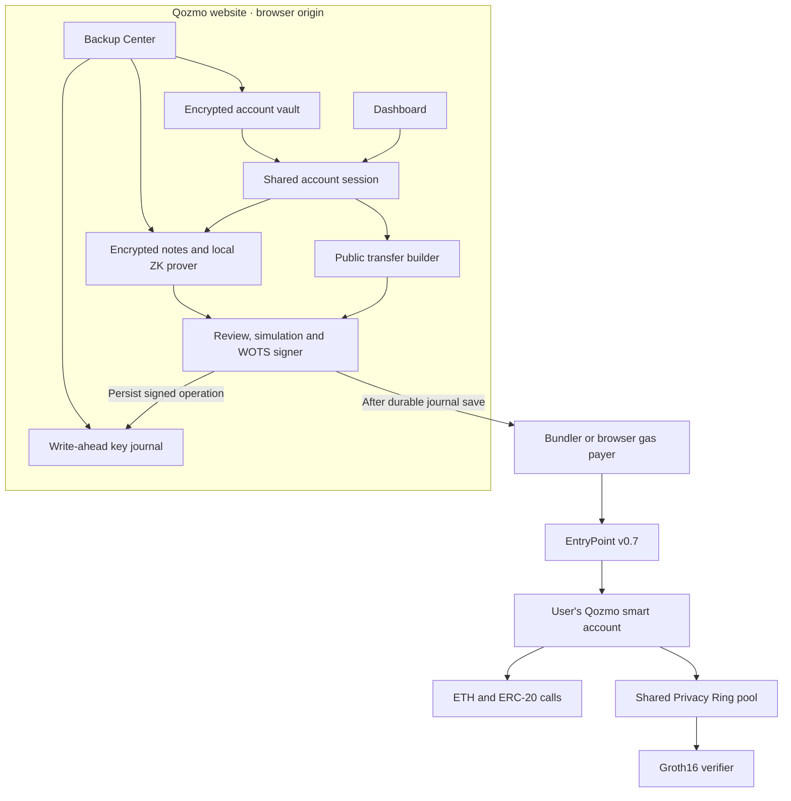
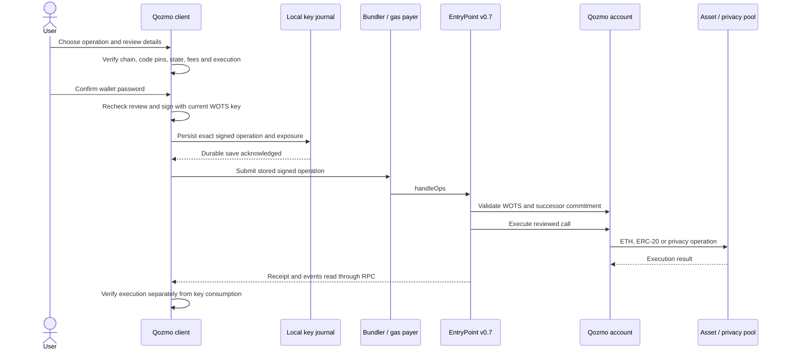
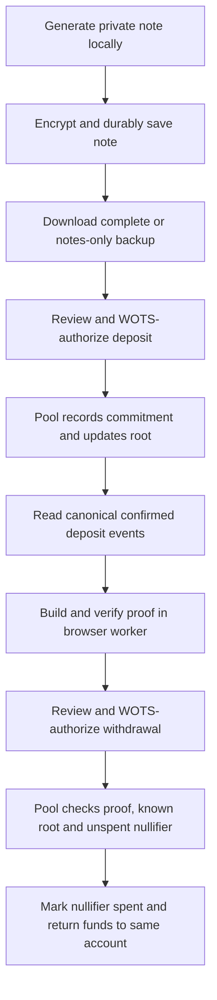

<p align="center">
  
</p>

<h1 align="center">Qozmo Wallet</h1>

<p align="center">
  Hash-based account authorization. Local zero-knowledge proofs. One shared wallet workspace.
</p>

<p align="center">
  <a href="#system-architecture">Architecture</a> ·
  <a href="#post-quantum-account-authorization">Quantum authorization</a> ·
  <a href="#privacy-ring">Privacy Ring</a> ·
  <a href="#getting-started">Get started</a> ·
  <a href="#validation-and-evidence">Validation</a>
</p>

> **Early access · Testnet research · Unaudited**
>
> Qozmo explores post-quantum account authorization with a WOTS/Keccak-256 smart account on Robinhood Testnet. Privacy Ring adds a separate Groth16-based privacy research layer. Hash-based account authorization does not make the proof system, network, browser, or device quantum-safe. Use test assets only.

## Contents

- [Overview](#overview)
- [System architecture](#system-architecture)
- [Post-quantum account authorization](#post-quantum-account-authorization)
- [Privacy Ring](#privacy-ring)
- [Backup and recovery](#backup-and-recovery)
- [Networks and deployed contracts](#networks-and-deployed-contracts)
- [Getting started](#getting-started)
- [Validation and evidence](#validation-and-evidence)
- [Security model and current limits](#security-model-and-current-limits)
- [Repository structure](#repository-structure)
- [Documentation](#documentation)
- [Attribution and references](#attribution-and-references)

## Overview

Qozmo combines a local encrypted wallet, hash-based smart-account authorization, and a browser-based privacy research interface. The website uses **one Qozmo smart account per user**: Wallet, Quantum, Privacy Ring, Activity, and Backup Center share its address, password, and unlocked session.

Public funds belong to the user's smart account. Deposited privacy funds belong to the shared pool contract and are controlled through note secrets and proofs. The pool is protocol infrastructure, not a second user wallet.

| Area | Current implementation |
| --- | --- |
| Shared website account | Deterministic ERC-4337 smart account with WOTS authorization on Robinhood Testnet |
| Public transfers | Reviewed test ETH and manually checked ERC-20 transfers |
| Privacy Ring | Fixed-denomination deposits, local proof generation, and withdrawals to the same Qozmo account |
| Backup Center | One encrypted file containing the account archive, known signing history, and encrypted privacy notes |
| Activity | Signed-call classification, execution checks, account fees, confirmations, and explorer links |
| Connections | Qozmo gateway, compatible HTTPS bundler, or an explicitly connected browser gas payer |
| Chrome extension | Manifest V3 side panel with Robinhood Quantum, native Solana Devnet, and Bitcoin Signet adapters |
| Markets and assets | Live crypto/RWA quotes, historical prices, supported onchain holdings, and DeFi discovery |
| Recovery workbench | Separate offline SLH-DSA research tools; no lost-device spending activation |

The **Mainnet/Testnet → Chain** picker controls the network being viewed. It does not bridge funds or activate signing on another chain. Previous EOA vaults remain available for encrypted export in Settings; assets are not migrated automatically.

## System architecture



### Responsibilities and data boundaries

| Component | Responsibility |
| --- | --- |
| Browser application | Generates secrets, encrypts local data, prepares calls, reviews transactions, and signs approved operations |
| Local journal | Retains every known exposed one-time key and its exact signed operation before submission |
| Local prover worker | Builds and verifies a withdrawal proof using the private witness and pinned public proving artifacts |
| RPC and indexers | Supply public chain state, receipts, deposit events, balances, and indexed history |
| Bundler / gas payer | Relays a signed UserOperation through EntryPoint; does not receive the wallet seed or vault password |
| EntryPoint and smart account | Validate account authorization and execute the requested calls |
| Privacy pool and verifier | Maintain commitments, reject spent nullifiers, verify withdrawal proofs, and release the fixed denomination |
| Optional Qozmo gateway | Proxies restricted bundler/history requests; upstream provider credentials remain server-side |

Seeds, note secrets, and wallet passwords are processed locally in the intended application flow. Public addresses, calldata, signatures, proofs, and transaction metadata are visible to the selected RPC or relay. The gateway is not a custody service or a gas sponsor.

Website and extension installations have different storage origins. Extension contexts share their encrypted records within that extension origin, but do not share an in-memory unlock session. Native SOL/BTC accounts use their own derivation and authorization; WOTS applies to the Robinhood smart account.

## Post-quantum account authorization

### What “quantum” means in this implementation

Qozmo's smart-account authorization uses **Winternitz one-time signatures (WOTS) with Keccak-256**. It is a custom hash-based construction preserved from the integrated account core. This repository makes no NIST certification claim for that construction and does not claim end-to-end post-quantum security.

| Parameter | Implementation |
| --- | --- |
| Seed | 32 random bytes, represented by a 24-word BIP-39 mnemonic |
| Hash function | Keccak-256 |
| Winternitz parameter | `w = 16` |
| Hash chains per key | 67: 64 message digits and 3 checksum digits |
| WOTS signature | 2,144 bytes |
| Normal UserOperation signature | 32-byte successor key commitment + WOTS signature = 2,176 bytes |
| Account transport | ERC-4337 UserOperation, EntryPoint v0.7 |

See the actual [WOTS implementation](lib/wallet/quantum-sdk/wots.ts) and [account encoding](lib/wallet/quantum-sdk/account.ts).

### Account creation and unlocking

1. Generate a fresh seed with browser cryptographic randomness and confirm the requested recovery words.
2. Derive the initial signing and recovery key commitments. Predict the stable smart-account address from the pinned factory, implementation, commitments, and account salt.
3. Encrypt the seed locally with **PBKDF2-SHA256, 600,000 iterations, and AES-256-GCM**. Account identity, network, commitments, salt, and restored/read-only policy are authenticated.
4. On unlock, decrypt locally and rederive the commitments and address. Wallet, Quantum, and Privacy Ring then use this same session.

The deterministic address can receive test ETH before deployment. Its first operation may include factory deployment, which also requires funding for account gas.

### One operation, one key

Each key index must authorize only one digest. The signature binds the reviewed UserOperation to its successor public-key commitment:

```text
userOpHash = ERC-4337 v0.7 operation hash
             bound to the operation, EntryPoint and chain

authorizationDigest = keccak256(userOpHash || nextPublicKeyHash)

signature = nextPublicKeyHash || WOTS_sign(currentKey, authorizationDigest)
```

The stable account address remains the same while the accepted signing commitment advances.



Preparation and confirmation check the configured chain, deployment block, runtime hashes, contract links, account state, balance, and execution. Reviews expire after two minutes; changed nonce, deployment, or increased fee requirements require a fresh review.

**A consumed key is not proof of successful execution.** Validation can consume a key even when the account call subsequently reverts. Activity checks the matching EntryPoint event and canonical receipt before showing verified success or account fees.

If submission is uncertain, Qozmo retains the signed operation. An explicit retry submits its identical stored bytes rather than signing a new message with the exposed key.

### Stateful-key safety

Same-origin Web Locks serialize operations and journal access. Missing or conflicting history blocks signing. Preserve the original signing device and export updated backups after signing: browser storage is not a hardware-backed anti-rollback system, and an old backup cannot establish that a key was never exposed elsewhere.

**Imported accounts remain read-only.** The separate recovery workbench uses SLH-DSA research artifacts, but those artifacts are not enrolled recovery authority for the deployed account and do not reactivate spending. See [recovery architecture and release requirements](docs/recovery-and-product-tools.md#chosen-recovery-direction).

## Privacy Ring

Privacy Ring is the product name for Qozmo's **commitment-pool research implementation**. The current protocol uses Merkle membership proofs, not cryptographic ring signatures.

### Protocol model

| Component | Current design |
| --- | --- |
| Supported asset in the dashboard | Native test ETH |
| Deployed denomination | `0.001 ETH` per note |
| Commitment tree | Poseidon, depth 8, at most 256 deposits |
| Circuit / proof | Circom and Groth16 over BN254 |
| Note material | Independent random secret and nullifier; each is 248 bits |
| Note storage | AES-256-GCM under a nonextractable, purpose-separated HKDF-SHA256 key derived from the account seed |
| Withdrawal destination | The same Qozmo smart account, full denomination, zero relayer fee in the current dashboard |

The SDK binds notes and proofs to their pool context:

```text
domain       = keccak256(abi.encode(protocol, chainId, pool, denomination)) mod Fr
commitment   = Poseidon(secret, nullifier, domain)
nullifierHash = Poseidon(nullifier, domain)
contextHash  = Poseidon(recipient, relayer, fee, domain)

Public proof signals: root, nullifierHash, domain, contextHash
Private witness: note secrets and Merkle path, with context inputs
```

Here, `protocol` is `qozmo-privacy-v1` and `Fr` is the circuit scalar field. The circuit proves ownership of a committed note and binds its spend to the withdrawal context. The pool rejects a previously spent nullifier.

### Deposit → proof → withdrawal



**Deposit.** The client checks the pinned pool and withdrawal artifacts, protects a fresh note, and requires a backup download before preparing funding. The same Qozmo account signs the deposit call. A saved note alone is not a funded balance.

**Proof.** The research scanner reconstructs sequential deposits at a confirmed canonical snapshot and verifies the tree root. A worker generates the proof locally using the archived WASM and proving key, verifies it locally, and returns public proof data. The client checks public-signal binding, and the pool call is simulated before signing.

**Withdrawal.** The same account signs the pool call with its next WOTS key. The pool verifies the proof and spend state before transferring the denomination. Public account gas must still be funded; the interface does not provide gas sponsorship.

These are two distinct authorization layers: **note secrets authorize the pool spend; WOTS authorizes the smart-account operation.**

### Privacy boundaries

Groth16/BN254 is **not post-quantum secure**. WOTS authorization does not change the proof system's security assumptions.

Amounts, funding addresses, withdrawal recipients, gas payments, commitments, roots, nullifier hashes, and transaction timing remain public. The current same-account round trip links its public endpoints and makes no anonymity claim. Encrypted local notes do not create encrypted onchain balances or confidential transaction amounts.

The research scan is bounded to one million blocks and 256 leaves. The client pauses new deposits before that scan range expires; longer-lived operation requires a reviewed historical indexer. Private-to-private transfers, variable-value notes, viewing keys, and selective disclosure are future protocol work.

The proving setup is single-machine research only. Preserve the exact deployed proving archive; generating a new setup does not reproduce keys compatible with the existing verifier. See [Privacy Ring implementation and artifact handling](docs/privacy-ring.md).

## Backup and recovery

Open **Backup Center** at `/dashboard/#backup` to export one complete encrypted file or authenticate a file without importing it.

| Included data | Why it matters |
| --- | --- |
| Account archive | Preserves the encrypted seed and account identity/salt |
| Known signing history | Preserves exposed keys and exact signed operations, including unresolved submissions |
| Privacy note archive | Preserves random note secrets that cannot be recreated from the recovery phrase |
| Authenticated snapshot | Checks the included counts and local-data fingerprint |

The complete `qozmo-wallet-backup` file has an AES-256-GCM outer envelope derived from the wallet password using PBKDF2-SHA256 at 600,000 iterations. Its owner, chain, format, export date, and KDF settings are authenticated. The account vault and note archive retain their own authenticated encryption.

Backup Center records the last download locally and detects changes in known history or notes. Its status is a local observation, not proof that an offline copy exists or that no other device exposed a key.

On a browser with no existing Qozmo account, **Import wallet → Encrypted archive** accepts a complete backup. Both contained archives are checked before restoration; existing accounts are not overwritten. Restored accounts stay read-only, and inspection never enables spending.

Keep the original device and journal. The recovery phrase alone cannot reconstruct random privacy notes or establish safe WOTS signing state. See [complete-backup workflow](docs/recovery-and-product-tools.md#complete-wallet-backup).

## Networks and deployed contracts

The website's signing adapter is restricted to **Robinhood Testnet, chain ID `46630`**. Other configured EVM chains are available for observation. The extension's native Solana Devnet and Bitcoin Signet adapters are separate account systems.

[Robinhood's network documentation](https://docs.robinhood.com/chain/connecting/) identifies Robinhood Chain as an Arbitrum L2 and lists its chain configuration. Qozmo's configured endpoints live in [networks.ts](lib/wallet/networks.ts); availability is an external dependency.

| Contract | Robinhood Testnet address |
| --- | --- |
| EntryPoint v0.7 | `0x0000000071727De22E5E9d8BAf0edAc6f37da032` |
| Qozmo account factory | `0xBe3a0B5f698a4F83C7679aAe7E7743D5E3d2F468` |
| Account implementation | `0xcCBA0b7B10f809e8f3B3C1e9835acDeEdC020c39` |
| Privacy Ring pool | `0x1bF754aCec18E5025Cd5a64F95C76A4B7F3eed0F` |
| Groth16 verifier | `0x16bE8A958188C55EFc385ECa5D2a1Ea04d34dB82` |
| Poseidon2 | `0x934EcAA425B420cf5bfB5C91B455604bC4bb8D24` |
| Poseidon4 | `0xbFc56f6757d75d6AB2E6F9cF42391f39b2F20982` |

These are shared infrastructure addresses; each user has a separate deterministic smart-account address. Exact pins and deployment records:

- [Account deployment manifest](lib/wallet/quantum-deployment.json)
- [Privacy deployment journal](privacy/deployments/46630.json)
- [Privacy runtime and configuration pins](lib/wallet/privacy/research-deployment.ts)

## Getting started

### Requirements

- Node.js **22 or 24** and npm.
- An up-to-date browser with WebCrypto and Web Locks; use HTTPS or localhost.
- Chrome **137+** for the extension side panel.
- Foundry's `anvil` for local blockchain integration checks.
- The `zip` command for extension packaging.

### Run the website

```bash
git clone https://github.com/imrybrndo/qozmo-wallet.git
cd qozmo-wallet
npm ci
npm run dev -- --port 3001
```

Open `http://localhost:3001`. Website routes:

| Route | Workspace |
| --- | --- |
| `/dashboard/` | Overview, assets, network selection, and public market data |
| `/dashboard/#quantum` | Wallet & Security, public transfers, shared connection, and pending operations |
| `/dashboard/#privacy` | Encrypted notes, deposits, local proofs, withdrawals, and recorded demo |
| `/dashboard/#backup` | Complete export, download freshness, and backup inspection |
| `/dashboard/#activity` | Account operations, execution details, and explorer history |
| `/dashboard/#payments` | Native payment requests and explicit receipt matching |
| `/recovery/` | Independent recovery research workbench |
| `/proof/` | Public WOTS evidence verification and project status |
| `/extension/` | Extension download and installation guide |
| `/docs/` | Searchable user and developer documentation |

### Configure an optional gateway

The static website can use a compatible user-supplied bundler or browser gas payer. To operate the optional Qozmo gateway, create a local `.env.local` from the sanitized [configuration template](.env.example), with values appropriate for your provider:

```dotenv
# Public frontend configuration: never put credentials here.
NEXT_PUBLIC_QOZMO_GATEWAY_URL=http://127.0.0.1:8787

# Server-only provider configuration.
QOZMO_BUNDLER_URL=https://your-provider.example/your-private-endpoint
QOZMO_ALLOWED_ORIGINS=http://localhost:3001,http://127.0.0.1:3001
QOZMO_GATEWAY_PORT=8787
```

Run `npm run gateway` in a separate terminal and restart the frontend after changing public configuration. In **Wallet & Security** or **Privacy Ring**, select **Qozmo bundler → Check & connect**. The panel distinguishes ready, unconfigured, wrong-network, and unavailable states; a successful check does not submit a transaction.

Provider credentials belong only on the gateway. A dedicated `WALLET_TESTNET` key in local `.env` is used by explicit CLI deployment/demo commands, not by the website wallet or ordinary local tests. Never commit a funded private key or put one in a `NEXT_PUBLIC_*` variable.

### Restore the existing pool's proving artifacts

A fresh checkout can run the frontend without the archived proving files. **New privacy funding stays disabled** until the exact deployed archive is available. Recorded evidence remains a separate read-only feature.

The current build expects this ignored archive directory:

```text
privacy/artifacts/23c992a98db9c84c17c5910115e088828cbef6f61505636817c12e9814fa7af1/
```

Restore the matching archive, including its manifest and local test report, then run:

```bash
npm run build:privacy
```

The build verifies source/artifact pins and packages only public proving assets into `public/privacy-prover/`. Both `npm run dev` and `npm run build` run this step. Do not regenerate a trusted setup as a substitute for the existing deployed verifier's artifacts.

For a **new, isolated research deployment**, follow the [setup, testing, and deployment procedure](docs/privacy-ring.md#run-the-complete-local-flow). Broadcast commands spend testnet gas and must be invoked explicitly.

### Build the website and extension

```bash
npm run typecheck
npm test
npm run build
```

The production website is a **static export** in `out/`. Deploy that directory to static hosting. The gateway is a separate service and needs its own deployment/routing; exporting the frontend does not provision it. Use a static file server to preview `out/`, rather than `next start`.

To package only the Chrome extension:

```bash
npm run build:extension
npm run verify:extension
```

Open `chrome://extensions`, enable **Developer mode**, choose **Load unpacked**, and select `dist/chrome/qozmo-wallet-extension/`. The toolbar opens the native side panel. The downloadable package is `public/downloads/qozmo-wallet-chrome.zip`.

Preserve the installation folder and browser profile when updating. Website vaults are not automatically synchronized into the extension. See the [Chrome extension guide](docs/chrome-extension.md) for permissions, supported flows, and installation limits.

## Validation and evidence

The recorded local validation snapshot from **12 November 2026** passed **175 tests**, along with TypeScript checks and the production build. This is an observed development result, not an independent security audit or hosted CI certification.

| Command | What it checks |
| --- | --- |
| `npm test` | Cryptography, journal persistence/conflicts, account policy, backups, call classification, receipts, connections, native adapters, and isolated UI behavior |
| `npm run typecheck` | TypeScript consistency |
| `npm run build` | Pinned prover packaging when available, extension packaging, and the static website build |
| `npm run wallet:unified:test` | Isolated Anvil deposit → browser-bundled proof → withdrawal → public transfer → complete backup verification |
| `npm run privacy:demo:test` | Isolated CLI demo lifecycle and evidence/tamper checks |
| `npm run verify:extension` | Extension package, manifest, local assets, checksum, and archive integrity |
| `npm run verify:wots -- --tx <hash> --account <address>` | Read-only verification of a supplied public WOTS transaction |

Artifact-dependent integration commands require the matching proving build/archive and `anvil`. Local blockchain tests use public development keys and do not require the user's `.env` signer.

### Recorded testnet evidence

An earlier CLI privacy demo completed on **11 November 2026** with a `0.001 ETH` deposit and withdrawal:

- [Recorded deposit transaction](https://explorer.testnet.chain.robinhood.com/tx/0xfb9e3a961fbb0449096a0eeaeb7d1e151c14863534a9e0331f121c68e8d519c6)
- [Recorded withdrawal transaction](https://explorer.testnet.chain.robinhood.com/tx/0xfe7df0106a7416dce878b29fe5fc54eb653a5e1b594853e7f0eafd4a47f64714)
- [Machine-readable public evidence](lib/wallet/privacy/demo-evidence.json)

This recorded CLI run is distinct from the newer unified WOTS-account integration, which has been exercised on isolated Anvil. Neither the local integration result nor the recorded CLI receipts establish a newly funded production-browser or installed-extension transaction. The dashboard offers an explicit fresh read-only check of the recorded evidence when RPC access is available.

## Security model and current limits

| Boundary | Current position |
| --- | --- |
| Account authorization | Custom WOTS/Keccak-256 research implementation; no independent audit or certification claimed |
| Privacy proof | Groth16/BN254; not post-quantum |
| Local key custody | Password-encrypted storage; unlocked secrets exist in browser memory |
| Stateful-key history | Same-origin serialization and durable journaling; cloned devices and storage rollback are not solved |
| Restored accounts | Read-only; backup possession does not activate lost-device spending |
| Privacy metadata | Public denomination, endpoints, gas, and timing; same-account withdrawal provides no anonymity claim |
| Mainnet | No activated Qozmo smart-account signing or Privacy Ring rollout |
| Extension native chains | Standard SOL/BTC authorization; not covered by WOTS |
| Relays and data providers | External availability, privacy, and service dependencies; no automatic sponsorship or silent submission retry |
| Future protocol features | Variable-value/private-to-private transfers, selective disclosure, and reviewed recovery activation remain unimplemented |

Execution simulation is a pre-signing check, not a guarantee of inclusion or outcome. A not-yet-deployed account has a more limited preview; the privacy client can simulate the target call without separately simulating the complete undeployed wrapper. Fees and public state may change, and confirmations are dated observations rather than irreversible finality.

The landing page also contains illustrative wallet/card concepts. Market quotes are not holdings, stock-token units are not necessarily underlying share counts, and viewing a DeFi protocol does not execute a deposit, swap, bridge, or staking transaction. No payment card or mobile application is issued by this repository.

Further release work includes independent circuit/contract/client review, stronger state and recovery guarantees, historical indexing beyond the bounded research scanner, browser/device performance checks, and funded testnet acceptance of the complete user journey.

## Repository structure

```text
app/                         Next.js routes and responsive styles
components/
  dashboard/                 Wallet views, markets, network picker, privacy interface
  wallet/                    Shared account, Backup Center, Activity, connection panel
  docs/                      Searchable documentation interface
lib/wallet/
  quantum/                   Qozmo account storage, chain policy, signing adapter
  quantum-sdk/               Integrated WOTS and ERC-4337 core
  privacy/                   Notes, events, calldata, prover adapter, deployment pins
  multichain/                Native Solana Devnet and Bitcoin Signet adapters
  account-backup.ts          Complete encrypted backup format and inspection
  account-activity.ts        Signed-call classification and execution-state mapping
  connection.ts              Managed-gateway health states
privacy/
  circuits/                  Circom withdrawal circuit
  contracts/                 Solidity commitment pool
  deployments/               Public deployment journal
  artifacts/                 Ignored archived proving builds
scripts/                     Build, gateway, deployment and verification tooling
extension/                   Manifest V3 entry points and UI-only service worker
tests/                       Cryptographic, transaction and UI regression coverage
public/                      Brand assets and generated public downloads
```

**Stack:** Next.js App Router, React, TypeScript, viem, noble/scure cryptography, WebCrypto, Solidity, Circom, snarkjs, and Poseidon. Local verification uses Node's test runner, JSDOM, and Foundry Anvil.

## Documentation

| Guide | Focus |
| --- | --- |
| [Privacy Ring](docs/privacy-ring.md) | Circuit, pool, artifact handling, deployment, evidence, and privacy assumptions |
| [Unified account workspace](docs/recovery-and-product-tools.md#unified-account-workspace) | Complete backups, Activity, shared connections, and recovery boundaries |
| [Quantum core integration](docs/qozmo-quantum.md) | Original integration, contract pins, storage design, and source provenance |
| [Chrome extension](docs/chrome-extension.md) | Side-panel installation, permissions, updates, and validation scope |
| [Native multichain adapters](docs/multichain-wallet.md) | Solana/Bitcoin derivation, transfer rules, and account separation |
| [Proof and release status](docs/proof-and-release-status.md) | Public WOTS evidence and mainnet release criteria |
| [Wallet implementation](docs/wallet-implementation.md) | Earlier EOA implementation and supporting wallet components |
| [Brand identity](docs/brand-identity.md) | Shared emblem, assets, and attribution |
| [Hero artwork](docs/hand-phone-asset.md) | Landing-page illustration and composition details |

Some implementation guides retain dated validation snapshots from earlier stages. This README describes the current unified website architecture; refer to the linked source modules and explicit evidence records when evaluating a particular release.

## Attribution and references

The WOTS/ERC-4337 core was integrated from the supplied Winternitz SDK checkout at source revision `42721b4f50ef6e48291a8de862fa76e9b570d42d`. Original cryptographic domains and wire formats are retained for compatibility. Per-file hashes and import adaptations are recorded in [provenance.json](lib/wallet/quantum-sdk/provenance.json).

Magic UI adaptations retain their [MIT notice](components/magicui/LICENSE). Review upstream code, proving-toolchain, and asset licenses before redistribution; this README does not assign a new repository-wide license.

Primary technical references:

- [ERC-4337 specification](https://eips.ethereum.org/EIPS/eip-4337) — account abstraction and UserOperations; this implementation pins the v0.7 deployment and encoding.
- [NIST FIPS 205](https://csrc.nist.gov/pubs/fips/205/final) — SLH-DSA, used in the separate recovery research workbench; not certification of Qozmo's WOTS construction.
- [Circom documentation](https://docs.circom.io/) and [snarkjs](https://github.com/iden3/snarkjs) — circuit/proof tooling.
- [Robinhood Chain documentation](https://docs.robinhood.com/chain/connecting/) — network configuration and infrastructure.
