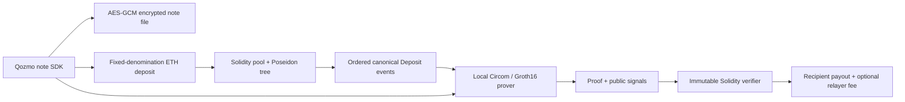

# Qozmo Privacy Ring — Phase 1 research implementation

Implemented in this repository: an EVM fixed-denomination native ETH pool, a Circom membership/spend circuit, a Groth16 verifier generation pipeline, a TypeScript note/calldata SDK, encrypted note backups, and a dashboard note lab at `/dashboard/#privacy`.

**Status: unaudited research prototype deployed to Robinhood Testnet (46630), with a completed deposit/proof/withdrawal demo.** The dashboard shares one Qozmo WOTS smart account for public transfers, Quantum security, deposit and withdrawal. It also retains the separate recorded evidence explorer. The single-machine proving setup must never secure real funds. “Privacy Ring” is the product name; this phase uses a commitment pool, not cryptographic ring signatures.

## One website wallet

Create or unlock the Qozmo account once. Overview, Receive, Send, Wallet & security, payments and Privacy Ring use the same address; feature navigation preserves that signing session. Lock, page exit, storage identity changes and inactivity clear it. An existing Qozmo Quantum record becomes the canonical account. Previous EOA vaults are preserved for encrypted export in Settings; there is no automatic asset migration. The native multichain extension remains a distinct origin and account model.

The privacy pool is shared infrastructure, not another user wallet. Public balance and unspent pool-note balance are distinct. Current dashboard withdrawals deliberately return the full denomination to the same smart account, publicly linking the endpoints; this is not an anonymity claim.

1. Receive test ETH into the Qozmo account on chain 46630, and connect a relay in Wallet & security or Privacy Ring.
2. Open Privacy Ring and create a protected note. Prover artifact integrity and pinned pool runtime/configuration are checked before preparing a deposit.
3. Download the encrypted notes backup, then review and confirm a 0.001 test ETH deposit with the **same wallet password**.
4. Verify notes onchain after confirmations. Select a funded note, generate its proof locally, review and confirm the withdrawal.
5. Inspect the verified operation receipt and export a fresh account archive after signing. A pending privacy operation also blocks public signing until reconciled.

Notes are stored with AES-256-GCM under a nonextractable key derived from the account seed using HKDF-SHA256, separated by purpose, account and chain. Owner, pool and commitment are authenticated. Durable encrypted storage must succeed before the UI prepares funding. Import merges authenticated notes for that same wallet. Random note secrets **cannot** be reconstructed from the wallet phrase; retain both account and note archives. Restored accounts stay read-only.

`npm run build:privacy` packages only the exact deployed archive’s public WASM, proving key, verification key and browser worker into ignored `public/privacy-prover/`. Both dev and production build run it. Preserve `privacy/artifacts/23c992a98db9c84c17c5910115e088828cbef6f61505636817c12e9814fa7af1/`; a fresh checkout without it leaves proving/deposit preparation disabled. Do not generate a new trusted setup for this existing pool. No `.env` signer enters the browser.

`npm run wallet:unified:test` starts an isolated Anvil chain with public runtime fixtures and a public development key. It checks a WOTS deposit, the actual browser-bundled proof, withdrawal and subsequent public transfer on the same account/key sequence. It never reads `.env` and is **not live testnet transaction evidence**. Unit/UI tests cover note ownership, storage failure, shared session/lock, artifact tampering, stale reviews and unresolved signing history.

## Recorded testnet deployment

Deployed on **11 November 2026** with immutable denomination **0.001 test ETH**. Exact receipts, constructor parameters, runtime code hashes, build pins and the read-only verifier proof test are recorded in [`privacy/deployments/46630.json`](../privacy/deployments/46630.json).

| Contract | Robinhood Testnet address |
| --- | --- |
| Poseidon2 | [`0x934EcAA425B420cf5bfB5C91B455604bC4bb8D24`](https://explorer.testnet.chain.robinhood.com/address/0x934EcAA425B420cf5bfB5C91B455604bC4bb8D24) |
| Poseidon4 | [`0xbFc56f6757d75d6AB2E6F9cF42391f39b2F20982`](https://explorer.testnet.chain.robinhood.com/address/0xbFc56f6757d75d6AB2E6F9cF42391f39b2F20982) |
| Groth16Verifier | [`0x16bE8A958188C55EFc385ECa5D2a1Ea04d34dB82`](https://explorer.testnet.chain.robinhood.com/address/0x16bE8A958188C55EFc385ECa5D2a1Ea04d34dB82) |
| QozmoPrivacyPool | [`0x1bF754aCec18E5025Cd5a64F95C76A4B7F3eed0F`](https://explorer.testnet.chain.robinhood.com/address/0x1bF754aCec18E5025Cd5a64F95C76A4B7F3eed0F) |

Deployment receipts and runtime code were checked, including chain, domain, denomination and dependency addresses. The four deployment receipts total **0.00007493518 test ETH** in gas fees. The deployed verifier accepted a real Groth16 proof and rejected an altered withdrawal context through `eth_call`; its gas estimate was **238,536**. This was a synthetic-root verifier test, not a pool deposit or withdrawal. No funds were deposited by these deployment and verification commands. Explorer source publication remains separate work; unified browser transaction integration is described above.

The frozen proving artifacts are archived locally under `privacy/artifacts/23c992a98db9c84c17c5910115e088828cbef6f61505636817c12e9814fa7af1/` (ignored by git). Preserve an independent copy to retain the proving key corresponding to this immutable verifier. Build manifest SHA-256: `23c992a98db9c84c17c5910115e088828cbef6f61505636817c12e9814fa7af1`.

## Dashboard demo

Open `/dashboard/#privacy` and explore **Deposit → ZK proof → Withdraw**. The cards explain a recorded testnet run; clicking a stage never sends a transaction. **Check testnet receipts** makes fresh read-only RPC checks of contract code, chain identity, at least three-block canonical receipts, exact calldata and events, proof verification, known root, spent nullifier, and receipt gas fees. Failed or unavailable checks clear the verified badge. The downloadable report contains only public evidence.

The first round-trip completed on **11 November 2026**:

- [Deposit 0.001 test ETH](https://explorer.testnet.chain.robinhood.com/tx/0xfb9e3a961fbb0449096a0eeaeb7d1e151c14863534a9e0331f121c68e8d519c6)
- [Withdraw the full 0.001 test ETH](https://explorer.testnet.chain.robinhood.com/tx/0xfe7df0106a7416dce878b29fe5fc54eb653a5e1b594853e7f0eafd4a47f64714)
- Total receipt gas fees: **0.0000076312 test ETH**. The sender is also the recipient and gas payer. The pool recorded the nullifier as spent; simulation of the same withdrawal returned `InvalidWithdrawal`.

Public evidence: [`lib/wallet/privacy/demo-evidence.json`](../lib/wallet/privacy/demo-evidence.json). The report deliberately associates the transactions for inspection. It is **not an anonymity demonstration**: amounts, addresses, gas payer and timing are public, and the pool has a very small anonymity set. The proof hides its private witness; it does not hide metadata or encrypt onchain balances.

```sh
# Read-only preview using WALLET_TESTNET from local .env:
npm run privacy:demo

# One deposit and one full withdrawal to the same signer; resumable and idempotent:
npm run privacy:demo -- --broadcast

# Test the complete runner and tamper checks on an isolated Anvil node, using a public fixture key:
npm run privacy:demo:test
```

The demo uses the frozen deployed proving artifacts and a bounded canonical Deposit-event scan from the pool's deployment block. The CLI saves an encrypted note to ignored `privacy/local/demo-46630.json` **before funding it**, and verifies that it can decrypt the note. The AES-GCM backup password is derived locally with HKDF-SHA256 from the dedicated testnet private key, domain-separated by demo version, chain, pool and build hash; it is never published. Recovery of an unfinished funded demo requires **both that encrypted journal and the original signer key**. The signer key alone cannot reconstruct random note secrets. This is a CLI demo recovery mechanism, separate from the unified dashboard account-note encryption.

The default demo gas budget is 0.001 test ETH, with a 1 gwei maximum fee-per-gas and a 1.5-million gas limit per step. A fresh demo requires balance for the deposit plus that reserve. Hashes are saved before each broadcast; ambiguous, dropped, replaced or failed transactions stop for manual reconciliation rather than sending duplicates. A completed journal is reused without another deposit or withdrawal. Preserve the journal and proving archive; do not delete them to rerun a funded note. After a successful run, only an explicit public schema is exported into the dashboard source JSON; private notes and signer material stay outside the browser bundle. Rebuild/reload to display updated recorded evidence.

## Run the complete local flow

Requirements: Node.js 22 or newer (tested on 24), npm, and Foundry's `anvil` on PATH. No wallet seed, API key, faucet, external RPC or funded account is required.

```sh
npm ci
npm run privacy:setup
npm run privacy:test
npm test
npm run typecheck
npm run build
```

`privacy:setup` compiles the depth-8 circuit with Circom 2 (the pinned `circom2` WASM distribution), generates a **single-machine research-only** powers-of-tau and Groth16 setup, exports the verifier, compiles Solidity, and generates Poseidon deployment bytecode. It takes a few minutes depending on the machine. It replaces only `privacy/build/`, which is ignored by git. Re-running changes the setup and verification key; earlier proofs will no longer match. It does not interact with a blockchain.

`privacy:test` starts its own ephemeral Anvil process on a random localhost port, deploys the actual Poseidon contracts, generated verifier and pool, deposits local test ETH, generates real proofs and withdraws. It tests altered recipient/fee/domain/root/proof, unauthorized fee relayer, historical roots, replay, failed payment rollback, reentrancy, invalid membership, and SDK/Solidity consistency. It shuts down that node on exit. Source hashes must match the setup manifest. `privacy/build/test-report.json` records local results and withdrawal gas; this is not a Robinhood Chain gas benchmark.

After contract-only edits, `npm run privacy:setup -- --contracts-only` can reuse the existing local setup if the circuit source hash is unchanged. Circuit changes require a full setup. Generated verifiers retain their upstream license notices. The compiler/hash generator are development-only tooling. A dedicated static browser worker contains the local Groth16 prover; circuit secrets are not sent to a server.

## Deploy to Robinhood Testnet

The deployment CLI reads `WALLET_TESTNET` from the process environment or project `.env` / `.env.local` (the latter overrides `.env`). It must be a dedicated EVM private key, with or without `0x`. Never place it in a `NEXT_PUBLIC_` variable. Optional `QOZMO_PRIVACY_RPC_URL` selects a provider; the default is Robinhood's public testnet endpoint. HTTPS is required except for localhost integration tests. RPC responses must report chain ID **46630** before signing or sending.

```sh
# First prepare and successfully test the exact build, if not already done:
npm run privacy:setup -- --contracts-only
npm run privacy:test

# Read-only preflight: signer public address, balance, chain and predicted contracts.
npm run privacy:deploy

# Sends four contract creations using testnet gas; no ETH pool deposit is made.
npm run privacy:deploy -- --broadcast

# Read-only receipt/code/dependency checks and a real proof against the deployed verifier.
npm run privacy:verify
```

The CLI deploys `Poseidon2`, `Poseidon4`, `Groth16Verifier`, then `QozmoPrivacyPool`. The pool's immutable denomination is **0.001 test ETH** (`1000000000000000` wei). Deployment has zero transaction value; the denomination is a pool parameter. Each transaction uses a fresh estimate, a 20% gas margin plus 10,000 gas, a 1 gwei maximum fee-per-gas limit, and a cumulative **0.005 test ETH** fee-cap budget. Actual fees depend on the chain; preflight does not claim an exact all-contract gas quote.

Artifacts and completed local-test evidence are checked against SHA-256 pins. Before the first send, proving artifacts are copied to ignored `privacy/artifacts/<manifestHash>/` so another setup cannot overwrite that deployment's proving key. Back up that directory independently; git will not save it. The public deployment journal is `privacy/deployments/46630.json`, containing addresses, hashes, receipt blocks, runtime code hashes, denomination and build pins. It never contains the wallet key or signed raw transactions. The archive is not an independent trust guarantee; the setup remains single-machine research only.

Rerunning `--broadcast` resumes the same journal and rechecks confirmed deployments without sending them again. The transaction hash is persisted before broadcast. If a send has an ambiguous outcome, the script stops rather than creating another deployment; check the saved hash and nonce on the explorer. A signed-but-unsent, dropped, replaced or reverted transaction requires manual reconciliation. Preserve the journal. A stale `.lock` after a crash must only be removed after confirming no deployment process is running. Changing signer, build or denomination cannot silently reuse an existing journal.

`privacy:verify` checks canonical receipts, exact creation inputs, deployed runtime hashes, pool parameters and Poseidon vectors. It then generates a synthetic-root membership proof and uses `eth_call` to check that the deployed verifier accepts it and rejects a modified context. This tests actual-chain BN254 proof verification **without depositing funds**. It does not establish that the synthetic root belongs to the pool or exercise an onchain pool withdrawal. The saved verifier gas estimate is not a pool-withdrawal gas benchmark. Blockscout source verification is a separate publishing step; runtime/receipt checks do not mean the explorer has verified source.

The dashboard now includes the recorded demo, fresh receipt verification and a note lab. General browser-initiated deposit/withdrawal still requires local proving, backup confirmation and a reviewed signing flow.

## Protocol



All arithmetic hashes use circomlib's Poseidon over the BN254 scalar field. Solidity uses bytecode from circomlibjs; the SDK uses poseidon-lite. The end-to-end test cross-checks their results against the circuit.

| Value | Definition |
| --- | --- |
| Domain | `keccak256(abi.encode("qozmo-privacy-v1", chainId, poolAddress, denomination)) mod FIELD` |
| Commitment | `Poseidon(secret, nullifier, domain)` |
| Spent marker | `Poseidon(nullifier, domain)` |
| Withdrawal context | `Poseidon(uint160(recipient), uint160(relayer), fee, domain)` |
| Parent node | `Poseidon(left, right)` |
| Empty leaf | `0` |

Each note contains independent random, nonzero 248-bit secret and nullifier values plus its chain, pool and denomination. They are bearer withdrawal secrets, unrelated to the EVM account mnemonic. The circuit proves their commitment belongs to a known root, derives the nullifier hash and binds the payout context. Public signal order follows circuit input **declaration order**: `[root, nullifierHash, domain, contextHash]`.

The contract accepts exactly one immutable public ETH denomination, at most 256 deposits, canonical field commitments, and one withdrawal per nullifier. All nonempty historical roots are retained, bounded by tree capacity. Proofs cannot be moved between different pool/chain/denomination domains. A fee-bearing withdrawal must be submitted by its proof-bound relayer. Fee-free proofs can be submitted by anyone; copying a proof still pays its fixed recipient. The nullifier is marked before external payments; failures revert the whole operation. Both entry points have a reentrancy guard. There is no admin, upgrade, verifier replacement or rescue key.

Deployment is restricted to local chain `31337`, Robinhood Testnet `46630`, and Sepolia `11155111`. Transactions reject a changed chain ID after deployment. Constructor addresses must contain code; this does not establish that dependencies are trustworthy. Any eventual deployment must pin the verifier, Poseidon bytecode and complete proving artifacts to reviewed source.

## SDK and dashboard

- `lib/wallet/privacy/note.ts`: create/validate notes, derive commitments and domains, reconstruct Merkle paths, prepare circuit witnesses.
- `lib/wallet/privacy/backup.ts`: AES-256-GCM backup with PBKDF2-SHA256, 600,000 iterations, fresh 16-byte salt and 12-byte IV. Entire note metadata is inside the authenticated ciphertext. Import strictly bounds schema, sizes and KDF work before decryption.
- `lib/wallet/privacy/transactions.ts`: typed pool ABI, offline deposit calldata and an async withdrawal builder with an injected prover. It checks returned public signals and proof coordinate encodings; the caller must verify/simulate the actual proof before signing. These functions do not sign, broadcast, or check deployment authenticity.
- `components/dashboard/privacy-panel.tsx`: selects the shared account Privacy Ring interface on the website. Its standalone research note lab remains available to isolated callers. `components/wallet/account-privacy.tsx` owns encrypted account-note management, confirmed status, local proof generation, operation review and receipt links. JavaScript cannot guarantee erasure of all runtime copies.

The research event scanner in `lib/wallet/privacy/events.ts` validates chain identity, sequential indices, canonical block hashes and the reconstructed root at a confirmed snapshot. The runner separately verifies pinned code/domain/denomination before handing leaves to `withdrawalWitness`. The scan is bounded to one million blocks and 256 leaves; it is not a general-purpose historical indexer. Reorgs require rebuilding from canonical events. An old root can remain valid in the deployed pool, but a root from an orphaned branch is not usable. Check the current root history and spent marker and simulate before submission.

The unified dashboard uses fixed deployment pins, artifact integrity checks, a canonical research event scan, local proof worker, backup download and WOTS transaction review. No balance is inferred solely from a note or downloaded backup: it must match a confirmed pool commitment and unspent nullifier. Current provider RPC availability and gas funding are still required.

## Privacy and quantum boundaries

Deposit sender, deposit/withdrawal amount, recipient, relayer, fee, gas payer, transaction timing and pool activity remain public. Fixed denominations avoid encoding a distinct amount per note but **do not provide confidential transaction amounts or encrypted onchain balances**. Membership proofs can hide which leaf is spent, subject to the anonymity set and metadata leakage. Small pools, direct gas funding, RPC/IP observations and correlated timing can identify users. There is no deployed relayer or network-privacy layer here.

Poseidon is a hash, not encryption. AES-GCM encrypts backups; it does not hide public EVM state. Neither private-to-private transfers nor encrypted balances are implemented in Phase 1.

The website uses the existing Qozmo WOTS account to authorize privacy pool calls, sharing its journal and key sequence with public transfers. The circuit’s note secrets authorize the pool spend; WOTS authorizes the outer smart-account operation. **Groth16/BN254 is not post-quantum secure.** Adding WOTS or SLH-DSA authentication would not change that fact. End-to-end post-quantum privacy needs a separately evaluated proof system and chain verification design, with security and gas benchmarks.

## Remaining phases and release requirements

1. Broader testnet integration: independent setup/artifact review, general historical indexing beyond the bounded research scan, independent browser/device performance review and privacy relayer operation. Deployment, actual-chain Groth16 verification and the recorded CLI round-trip are implemented; the dashboard retains that evidence separately and now supports shared-account signing with local proving.
2. Variable-value notes with constrained range/conservation, change outputs and encrypted recipient note delivery; private balance derived from confirmed unspent notes.
3. Private-to-private transfers, scanning keys and reliable recipient discovery; prevent double-spends and value creation across all paths.
4. Deliberately designed selective disclosure, scoped viewing keys and an explicit policy model; encrypting a backup alone is not selective disclosure or compliance.
5. Extension/mobile integration, independent circuit and Solidity audits, browser/device performance measurements, recovery review, deployment monitoring and a reviewed rollout.

The installed upstream development tooling may have transitive advisories (notably ethers 5/elliptic through the Poseidon bytecode generator). The generator is used only for hash bytecode generation; Qozmo does not use it for signing. Review these dependencies and their licenses before distributing a proving toolchain. Overrides patch available high-severity transitive issues; this does not constitute a security audit.

## Primary references

- [Robinhood Chain connection details](https://docs.robinhood.com/chain/connecting/) — official chain IDs and endpoints. Robinhood Chain is an Arbitrum L2, not an OP Stack chain.
- [Circom circuit documentation](https://docs.circom.io/)
- [iden3 snarkjs](https://github.com/iden3/snarkjs) — proving setup, Groth16 proving and Solidity verifier export.
- [iden3 circomlib](https://github.com/iden3/circomlib) and [circomlibjs](https://github.com/iden3/circomlibjs)
- [poseidon-lite](https://github.com/vimwitch/poseidon-lite)
